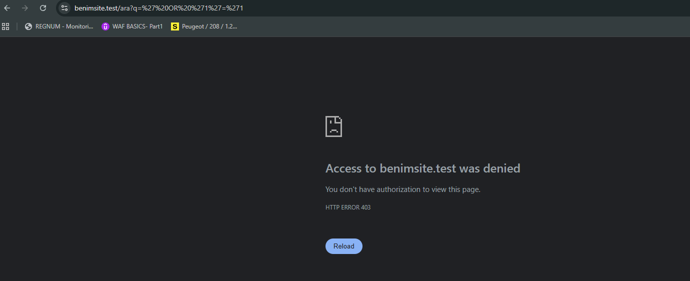
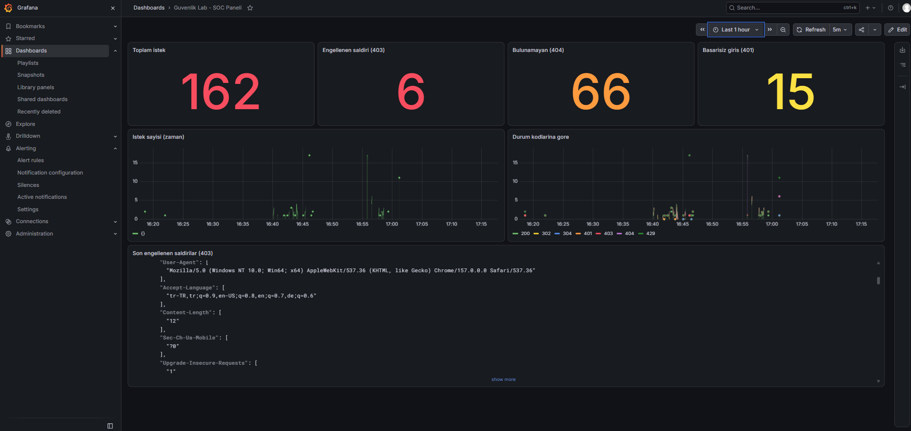
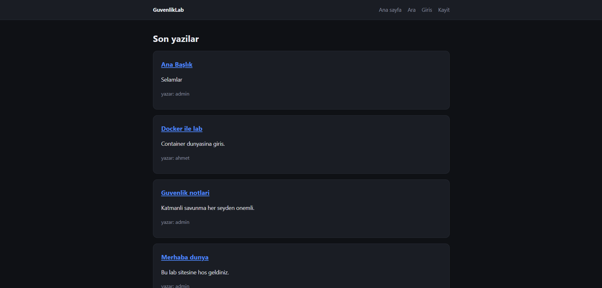
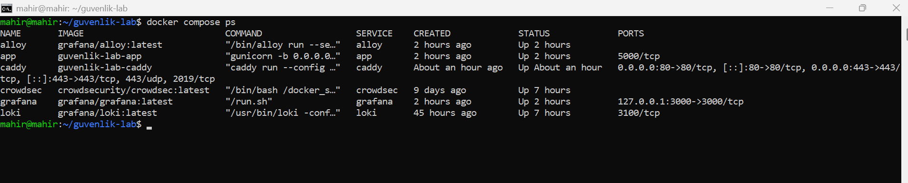

# 🛡️ Katmanlı Web Güvenliği Lab

Kasıtlı zafiyetli bir web uygulamasının etrafına kurulmuş, uçtan uca **katmanlı güvenlik (defense-in-depth)** laboratuvarı. OWASP Top 10 (2025) zafiyetleri önce sömürülür, sonra hem **kod** hem de **WAF** düzeyinde kapatılır; saldırılar bir **SIEM** üzerinden izlenir.

> ⚠️ **Uyarı:** Uygulama eğitim amaçlı *kasıtlı zafiyetlidir*. Yalnızca izole bir yerel ortamda çalıştırın; internete açık sunucuda veya üretimde kullanmayın.

## Mimari

```
Internet
   |  HTTPS (TLS)
   v
+-----------------------------------------------+
|  Caddy (edge)                                 |
|  TLS - Guvenlik basliklari (HSTS/CSP/...)     |
|  CrowdSec bouncer - Coraza WAF (OWASP CRS)    |
+------------------------+----------------------+
                         |  (internal)
                         v
             +-------------------------+
             |  Flask app (gunicorn)   |
             |  Kod savunmalari +      |
             |  rate limit             |
             +-----------+-------------+
                         |  loglar (internal)
                         v
            Alloy  ->  Loki  ->  Grafana  (SIEM)
```

## Kapsam

- **OWASP Top 10 (2025):** A01-A10, her biri somuruldu ve katmanli kapatildi
- **Enjeksiyon:** SQLi - Reflected/Stored XSS - SSTI - OS Command Injection
- **Erisim / mantik:** IDOR - SSRF - Insecure Deserialization (pickle RCE)
- **WAF:** Coraza + OWASP Core Rule Set (`On` / `DetectionOnly`)
- **IPS:** CrowdSec davranissal IP engelleme
- **Rate limiting:** Flask-Limiter (brute-force korumasi)
- **SIEM:** Loki + Alloy + Grafana — 7 panelli pano, LogQL
- **Konteyner sertlestirme:** non-root - read-only FS - `cap_drop: ALL` - no-new-privileges
- **Ag segmentasyonu:** edge / backend / monitor

## Teknoloji Yigini

Python (Flask, gunicorn) - Caddy - Coraza WAF - CrowdSec - Docker Compose - Loki - Alloy - Grafana

## Ekran Goruntuleri

| WAF saldiriyi engelliyor (403) | Grafana SIEM panosu |
| --- | --- |
|  |  |

| Uygulama (normal akis) | Tum yigin ayakta (docker compose ps) |
| --- | --- |
|  |  |

## Kurulum

```bash
git clone https://github.com/mahirkau1/guvenlik-lab.git
cd guvenlik-lab
cp .env.ornek .env        # kendi gizli degerlerini gir
docker compose up -d --build
```

## Dizin Yapisi

```
guvenlik-lab/
├── app/               # Flask uygulamasi
├── caddy/             # Caddyfile + WAF yapilandirmasi
├── alloy/             # log toplayici
├── grafana/           # datasource + panolar
├── screenshots/       # README gorselleri
├── docker-compose.yml
├── .env.ornek         # ornek env (gercek sir yok)
└── .env               # GIZLI — repoda yok
```

## Guvenlik Notu

Gizli anahtarlar (`SECRET_KEY`, API anahtarlari, Grafana parolasi) `.env` icinde tutulur ve `.gitignore` ile repodan dislanir. Seed kullanici parolalari yalnizca demo amaclidir.

---

**Hazirlayan:** Kaan Budak — SOC L1 → Guvenlik Muhendisligi hedefi
